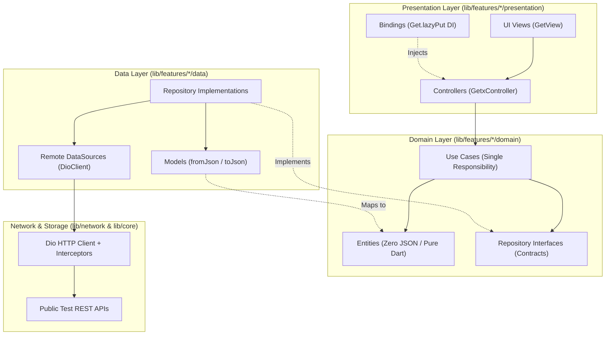

<div align="center">

# Flutter Core

**Clean Architecture + GetX Master Starter Project** — The production-ready master boilerplate for modern Flutter applications.

[-02569B?style=for-the-badge&logo=flutter&logoColor=white)](https://flutter.dev)
[](https://dart.dev)
[](https://pub.dev/packages/get)
[](https://github.com/SheikhAman/flutter-clean-architecture-getx)
[](https://github.com/SheikhAman/flutter-clean-architecture-getx)
[](#roadmap)

*Generic, reusable, and completely free of company-specific endpoints or hardcoded credentials. Boots on first run to a live Showcase Hub.*

[Showcase](#-showcase-hub) · [Architecture](#-clean-architecture-overview) · [Quick Start](#-quick-start) · [Auth & Demo OTP](#-auth--demo-otp) · [Structure](#-project-structure) · [Roadmap](#-roadmap)

</div>

---

## Why this exists

Starting a new Flutter project often requires repeating hundreds of lines of boilerplate: setting up Dio clients, logging interceptors, reactive state management, auth screens, dynamic light/dark theming, localization, input validation, empty states, and error handling.

**Flutter Core** provides a robust, pre-tested Clean Architecture foundation with GetX. It boots directly from a 2-second splash screen to a feature-rich **Showcase Hub** linking to every live demo.

---

## Clean Architecture Overview

Every feature follows strict separation of concerns into three decoupled layers:



### Architectural Rules Enforced
1. **Presentation Layer:** Views (`GetView`) contain only UI. Controllers (`GetxController`) coordinate state and invoke Use Cases. Controllers **never** call Dio or DataSources directly.
2. **Domain Layer:** The core of the app. Entities contain business attributes with no JSON/database dependencies. Use Cases encapsulate single business actions. Repository interfaces define contracts.
3. **Data Layer:** Handles data retrieval and serialization. DataSources interact with HTTP/local storage; Models serialize JSON; Repository implementations satisfy domain contracts.
4. **Dependency Injection:** Every screen has a dedicated `Bindings` class using `Get.lazyPut` to wire DataSources, Repositories, Use Cases, and Controllers.

---

## Features & Demos

| Category | Modules & Screens | Details |
| :--- | :--- | :--- |
| **Showcase Hub** | `ShowcaseScreen` | Central hub featuring categorized cards to launch every live demo in the project |
| **Clean Architecture Module** | `Posts Dashboard`<br>`PostDetailScreen` | Real-world 3-layer feed with listing, reading, and creating posts via `GetPostsUseCase`, `GetPostDetailUseCase`, and `CreatePostUseCase` (JSONPlaceholder) |
| **Authentication Suite** | `LoginScreen`<br>`RegisterScreen`<br>`OtpScreen` | Full validation, device metadata harvesting, and 6-digit pin code entry (**Demo OTP: `112345`**) |
| **Design System** | `WidgetDemoScreen` | Custom inputs (`AppTextField`), buttons (`AppButton`, `AppLoaderButton`), shimmer loading, and toasts |
| **Networking & API** | `ApiDemoScreen` | Dio REST operations (GET, POST, PUT, multipart upload) with logging interceptor |
| **Theming & Color Seeds** | `ThemeDemoScreen` | Material 3 dynamic theme generation across **6 color seeds** with instant light/dark mode switching |
| **Background Services** | `DownloadDemoScreen` | Background file downloader with real-time percentage progress bar and file caching |
| **Utility & Fallback States** | `EmptyDemoScreen`<br>`NetworkErrorScreen`<br>`WebViewScreen`<br>`UnknownRouteScreen` | Reusable empty illustrations, offline connection detection with retry, native WebView with progress, and 404 safety-net router |
| **Localization** | `AppTranslations` | Instant runtime toggle between English (`en_US`) and Bengali (`bn_BD`) |

---

## Auth & Demo OTP

1. Navigate to **Login** or **Register** from the Showcase Hub.
2. Form fields collect credentials alongside non-sensitive device info (model, brand, OS version).
3. On submit, navigate to the **OTP Verification** screen.
4. Enter the public demo OTP: **`112345`** (or tap the demo autofill banner).
5. The screen validates the OTP through `VerifyOtpUseCase` and returns to the Showcase Hub.

---

## Quick Start

### Prerequisites
- **Flutter SDK:** 3.41.9 (stable)
- **Dart SDK:** 3.11.5

### Run the App

```bash
# Clone the repository
git clone https://github.com/SheikhAman/flutter-clean-architecture-getx.git
cd flutter-clean-architecture-getx

# Fetch dependencies
flutter pub get

# Run static analysis (0 errors, 0 warnings enforced)
flutter analyze

# Run complete automated test suite
flutter test

# Run app on connected device or emulator
flutter run
```

---

## Project Structure

```text
lib/
├── core/
│   ├── constants/             # AppConstants (Demo OTP, public test URLs)
│   ├── services/              # DownloadService, LocationService, DeviceInfo
│   ├── storage/               # LocalPreferences (GetStorage)
│   ├── theme/                 # AppTheme, AppColors (6 M3 seeds), ThemeController
│   ├── utils/                 # AppToast, validators, screen utilities
│   └── widgets/               # AppButton, AppLoaderButton, AppTextField, AppEmptyState, LanguageToggle
├── features/
│   ├── auth/                  # Domain (entities, usecases, repo interface) + Presentation (Login, Register, OTP)
│   ├── common/                # EmptyDemo, NetworkError, WebView, UnknownRoute
│   ├── posts/                 # 3-Layer Clean Architecture Showcase (List, Detail, Create)
│   ├── showcase/              # Showcase Hub + Widget, API, Theme, and Download demos
│   └── splash/                # Splash screen with auto-navigation
├── languages/                 # AppTranslations (English & Bengali)
├── network/                   # DioClient, LoggingInterceptor, InternetChecker, ApiConstants
├── routes/                    # AppRoutes, AppPages (GetPage routes & bindings)
└── main.dart                  # ScreenUtilInit + GetMaterialApp entrypoint
```

---

## CI & Automated Quality Gates

This repository enforces automated quality gates on every commit via GitHub Actions (`.github/workflows/ci.yml`):
- `flutter analyze` must pass with **0 errors and 0 warnings**.
- `flutter test` runs the comprehensive test suite covering:
  - Unit tests for all Use Cases (`LoginUseCase`, `RegisterUseCase`, `VerifyOtpUseCase`, `GetPostsUseCase`, `GetPostDetailUseCase`, `CreatePostUseCase`).
  - Widget tests for all screens (`ShowcaseScreen`, `LoginScreen`, `OtpScreen`, `WidgetDemoScreen`, `ApiDemoScreen`, `ThemeDemoScreen`, `DownloadDemoScreen`, `EmptyDemoScreen`, `NetworkErrorScreen`, `WebViewScreen`, `PostListScreen`, `PostDetailScreen`).

---

## Roadmap

- [x] REST / Dio API edition with timeouts, retry, and logging interceptor
- [x] Component Showcase Hub with zero white screens and 100% working demo links
- [x] Clean Architecture domain layer with single-responsibility Use Cases and pure Entities
- [x] Production Authentication Suite (Login, Register, 6-digit OTP verification)
- [x] Dynamic Material 3 theming with 6 palette seeds and persistent dark mode
- [x] Third decoupled business feature (Posts Dashboard) proving scalability
- [x] Reusable offline, empty, and 404 error recovery states
- [ ] Firebase edition (Firebase Auth, Firestore, Cloud Functions, and Remote Config) *(Planned)*
- [ ] Real SMS OTP provider integration (Twilio / Firebase Phone Auth) *(Planned)*

---

<div align="center">

**Master starter template. Build once, scale everywhere.**

</div>
